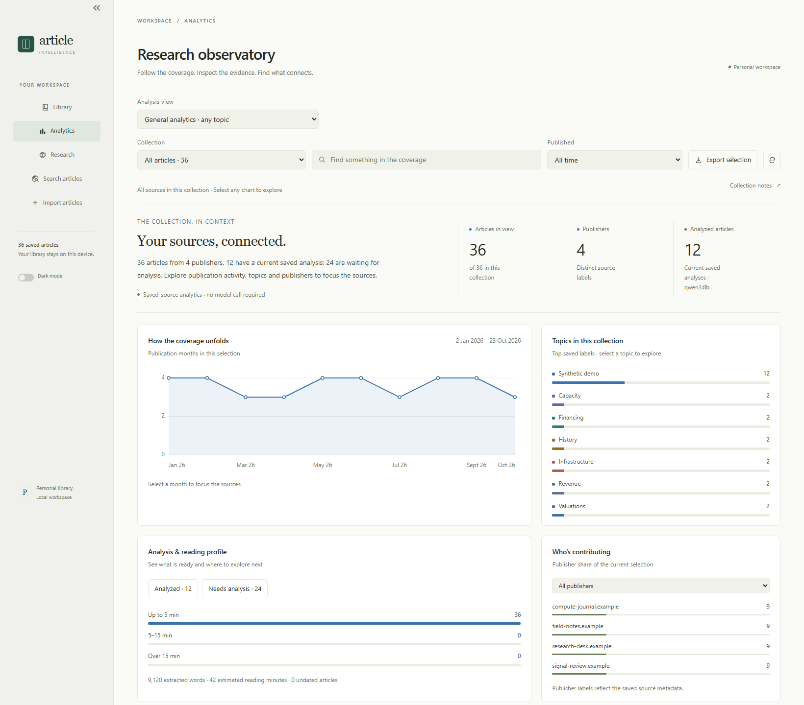

# Article Intelligence

A local research workspace for collecting articles, comparing coverage, and returning to the evidence. Save reading copies, organize your notes, explore a collection, and optionally ask a local model questions with passage citations.

Built with Python, Streamlit, SQLite, Playwright, and Ollama. Intended for personal research on your own machine.


## What you can do

- **Build a library.** Import public article URLs, keep a separate PDF for each article, and search saved text with indexed filters and pagination.
- **Discover sources.** Search recent news by topic, keywords, publisher, date, and language; preview results before importing a selection.
- **Explore any topic.** General analytics links publication trends, publisher share, saved topics, analysis status and reading profiles. Track 30-day publication momentum, compare topic labels by publisher, and inspect metadata/capture readiness. Choose the specialist AI investment view for company mentions and six inspectable coverage lenses.
- **Keep your own research.** Add notes, personal tags, project collections, and highlights anchored to a particular text revision.
- **Use local AI when you need it.** Generate cited summaries and takeaways, search semantically, ask questions across saved articles through Ollama, and download a cited Markdown brief or complete JSON result.
- **Take your work with you.** Export filtered metadata, download reading PDFs, or back up and restore the library with annotations and saved analyses.

Library search, reading, notes, exports, and coverage analytics work without a running model. Themes support light and dark appearances.

Library and Research separate **General filters** from **Topic filters**. Topic labels and personal tags come from all matching source articles under the current search/collection and metadata filters, rather than unrelated analyses elsewhere in the library. Stale selections clear when the context changes. AI investment-specific Library controls require an explicit opt-in. Sources without saved topic labels remain searchable and show that no labels are available.

Analytics opens in **General analytics**, for any collection or language. Metadata charts work immediately; topic charts use current saved `qwen3:8b` analyses and disclose missing labels. The reading room's empty Analysis tab opens Research focused on that single article. Repeated identical questions can reuse the last session result; **Generate a fresh result** bypasses reuse. Evidence cards expose the cited passages directly. Your last completed result stays available if a new request fails, model discovery goes offline or your filters change. Clear it explicitly or download its original evidence and source-selection metadata before ending the session.



## Run locally

Use **Python 3.13**. Windows and native Ubuntu/WSL2 x86_64 have been checked, along with the local Docker image. See [installation and recovery](docs/installation.md) and the [actual validation matrix](docs/validation.md) for platform details and pending checks. Run from the folder containing `app/`, `README.md`, and `requirements.txt`.

Windows / PowerShell:

```powershell
py -3.13 -m venv .venv
.\.venv\Scripts\python.exe -m pip install -r requirements.txt
.\.venv\Scripts\python.exe -m streamlit run app/dashboard.py
```

Open **http://localhost:8501**. A fresh checkout starts with an empty library. Import a few public article URLs to begin, or try the synthetic demo below. Virtual environment activation is optional; the commands above work without changing PowerShell's execution policy.

Linux / Bash, with a separately installed Python 3.13:

```bash
python3.13 -m venv .venv
.venv/bin/python -m pip install -r requirements.txt
.venv/bin/python -m playwright install --with-deps chromium
.venv/bin/python scripts/check_install.py --browser
.venv/bin/python -m streamlit run app/dashboard.py
```

Docker Compose:

```sh
docker compose up --build -d --wait
```

Open **http://127.0.0.1:8501**. Compose uses isolated persistent volumes and a non-root, sandboxed-browser runtime. If a native app already uses that port, set `ARTINT_PORT=8503` before starting Compose. Installation/model diagnostics, Ubuntu namespace requirements, optional Ollama networking, backups and explicit native-to-container migration are covered in the [installation guide](docs/installation.md). Native macOS, ARM64 and container GPU configurations remain unvalidated; one native Windows RTX 5050 inference profile has been checked.

Auto capture tries normal HTML first, then a bounded browser session for incomplete JavaScript pages. If Chrome or Edge is unavailable, install Chromium:

```powershell
.\.venv\Scripts\python.exe -m playwright install chromium
```

For optional AI features, install and start [Ollama](https://ollama.com/), then pull the default models:

```powershell
ollama pull qwen3:8b
ollama pull qwen3-embedding:0.6b
```

Model inference runs locally with the default native loopback endpoint; performance depends on your hardware. **Research settings** shows model selection and connection status. Set `OLLAMA_BASE_URL` before starting the app to configure another endpoint. See the [operating guide](docs/usage.md) for capture options, search behavior, model configuration, backups, and CLI usage. Container-to-host Ollama connectivity is optional and must be configured explicitly.

Choose **Check model status** in Research settings to inspect installed versus loaded models, runtime compatibility, reported context and GPU/CPU model-memory residency. The snapshot reads metadata without loading a model; unloaded and unavailable states remain explicit. An optional startup check is `python scripts/check_install.py --ollama`, using your environment's Python. See [diagnostics](docs/installation.md#model-readiness-and-residency-checks).

New analyses and research answers automatically choose **8K or 16K context**, reserving 1,600 output tokens plus a safety margin. An estimate selects the first window; server context checks and reported token counts can expand the complete request to 16K. Requests that cannot fit fail without saving a shortened answer. These controls require **Ollama 0.40.11 or newer**, the oldest checked runtime. Existing saved analyses remain available offline.

For native Windows NVIDIA inference, the optional [GPU launcher](docs/installation.md#optional-native-windows-nvidia-inference) selects CUDA and enables Flash Attention while preserving the model and default KV-cache precision. On the checked 8 GB RTX 5050 laptop, `qwen3:8b` loaded entirely on GPU at 8K and partly on CPU at 16K. Actual placement depends on available VRAM. `qwen3:8b` remains the default; the installed Qwen 3.5 9B is selectable but has not established better research quality.

The launcher defaults to `f16`; `-KvCacheType q8_0` explicitly opts into a lower-memory cache experiment with a precision tradeoff. It writes a local requested-profile manifest, does not change persistent settings and does not switch the app's model default. Compare actual runner placement and source-backed results before adopting it.

## Try the synthetic demo

The screenshots use **36 fictional articles from four fictional publishers**. No publisher article text or personal library is distributed. Example analyses are hand-authored fixtures, not evidence of model quality. The generator makes no network or model calls and refuses to write into a nonempty destination.

```powershell
.\.venv\Scripts\python.exe scripts/seed_demo.py
$env:ARTICLE_LIBRARY_DB = "$PWD/output/demo/library.db"
$env:ARTICLE_PDF_DIR = "$PWD/output/demo/pdfs"
.\.venv\Scripts\python.exe -m streamlit run app/dashboard.py
```

Stop Streamlit with Ctrl+C. Before opening your normal library in the same terminal, clear the two overrides:

```powershell
Remove-Item Env:ARTICLE_LIBRARY_DB, Env:ARTICLE_PDF_DIR
```

The default library is `data/articles.db`; reading PDFs live in `output/pdfs/`. Both directories are ignored by Git. To make another demo, use `--output output/demo-2` and update the two overrides to match.


## Development and checks

```powershell
.\.venv\Scripts\python.exe -m pip install -r requirements-dev.txt
.\.venv\Scripts\python.exe -m pip check
.\.venv\Scripts\python.exe -m pytest -q
```

The default suite uses offline fixtures. Enable the extraction browser test with installed Chrome/Edge/Chromium:

```powershell
$env:RUN_BROWSER_TESTS = '1'
.\.venv\Scripts\python.exe -m pytest -q
Remove-Item Env:RUN_BROWSER_TESTS
```

The separate live-server installation test requires the disposable server started by `scripts/validate_native.py` or `scripts/validate_container.py`; it remains skipped in an ordinary suite run. The latest Windows checkpoint passed 286 tests with that installation test skipped. The research/gold-authoring tools separately passed 55 targeted tests on the existing Ubuntu/WSL2 Python 3.13 environment. This is not a fresh Linux install or full later-change Linux/Docker revalidation; see the [validation record](docs/validation.md).

[GitHub Actions](.github/workflows/tests.yml) defines Windows/Python 3.13, Ubuntu/Python 3.13 and disposable Docker validation. The expanded workflow has not yet run remotely; local results are in [validation](docs/validation.md). `requirements.txt` pins direct runtime dependencies; `requirements-lock.txt` records the Windows/development environment and `requirements-linux-lock.txt` records the clean Linux runtime resolution.

`python scripts/check_install.py --browser` reports installation and actual Linux sandbox status without opening your library. `python scripts/smoke_install.py` checks search, PDF export, annotations and portable restore in temporary storage. With development dependencies installed, `python scripts/validate_native.py` checks a disposable live UI, and `python scripts/validate_container.py` builds/tests its own isolated Compose project. Neither validator uses your real library.

## Evaluate the research pipeline

The [research evaluation harness](docs/research-evaluation.md) freezes source hashes and gold character spans, runs the existing retriever/answer pipeline in an isolated cache, and writes per-case reports, review packets and paired comparisons. Start offline:

```powershell
.\.venv\Scripts\python.exe scripts/evaluate_research.py run --corpus tests/fixtures/research/synthetic-v1.json --output output/evaluations/my-research-smoke --engine fixture --mode retrieval
```

Open `output/evaluations/my-research-smoke/report.md`. The 24 original synthetic cases and scripted fixture engine test the harness, not real-world model quality. Actual Ollama runs are explicit; three-case Qwen retrieval/answer smoke checks succeeded locally. Human-reviewed development/held-out data and claim-support judgments remain pending. Persistent hybrid retrieval and durable research sessions are still planned.

The authoring tools can snapshot selected saved sources without modifying the library, draft proposed questions, and create offline case or batch pages for human gold review. The current private batch has 60 unreviewed proposals with AI-assisted corrections; this is not a completed human-labeled development set. The [batch workflow](docs/research-evaluation.md#review-suggestions-as-one-batch) shows all cases, changes, concrete expected facts and full source copies together, with grouped selection, explicit decisions and resumable exports. See the [gold-authoring workflow](docs/research-evaluation.md#prepare-real-development-proposals-and-review-gold-labels) for exact source-span selection and validated application of human decisions. Publisher text remains outside Git.

## Scope and limitations

This is a local research MVP. Authentication, shared workspaces, cloud deployment hardening, and a durable general-purpose ingestion queue remain future work. Free news discovery depends on provider availability and terms; search result counts are requests, not guarantees of available or importable articles.

Captures can be incomplete, blocked, or missing metadata. Capture diagnostics flag possible issues for review; they do not establish factual accuracy. The existing 100-source diagnostic cohort does **not** establish the planned 90% extraction completeness target. AI answers and summaries also need checking against their cited passages.

The specialist AI investment view uses English keyword rules and company aliases. These are text mentions, not sentiment scores or verified financial relationships. General analytics supports Unicode metadata and saved topic labels, but does not translate labels or provide evaluated multilingual claim analysis. PDFs are text reading copies, not faithful page archives or OCR. Images remain references.

Use sources you are authorized to access and reproduce. Capture respects robots checks and does not bypass sign-in or paywalls. Keep the server bound to localhost; this application has not been hardened for an untrusted multi-user deployment.

## Project documentation

- [Proposed next-release plan](docs/roadmap.md): evaluation, portability, retrieval, saved research and cross-publisher comparison.
- [Installation and recovery](docs/installation.md): Windows, Linux and Compose setup, diagnostics, model connectivity and backups.
- [Validation record](docs/validation.md): latest Windows checkpoint, historical portability checks and pending verification.
- [Extraction review workflow](docs/extraction-evaluation.md): prospective cohorts, phase-bound human checklists, source-type accounting and unresolved quality gates.
- [Research evaluation](docs/research-evaluation.md): frozen gold spans, offline/actual-model runs, human atomic-claim review and paired diagnostics.
- [Operating guide](docs/usage.md): detailed workflows and configuration.
- [Architecture](architecture.md): data flow, storage, trust boundaries, and planned evolution.
- [Requirements](requirements.md): product scope and acceptance criteria.
- [Milestones](milestones.md): completed work, historical measurements, and outstanding validation.
- [Changelog](CHANGELOG.md): unreleased changes and their verification limits.
- [Publishing guide](docs/publishing.md): review and push your local repository.

## License

[MIT](LICENSE) for this project's code and original synthetic fixtures. Third-party dependencies and publisher content retain their own licenses and rights.
