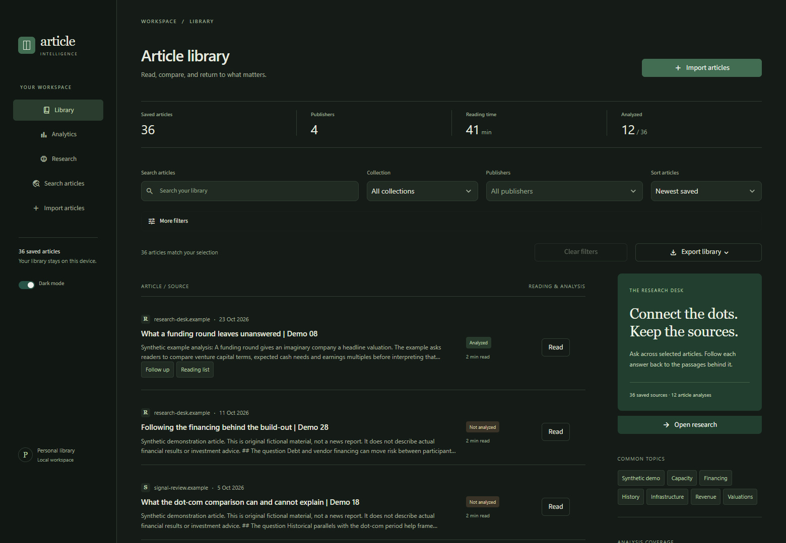
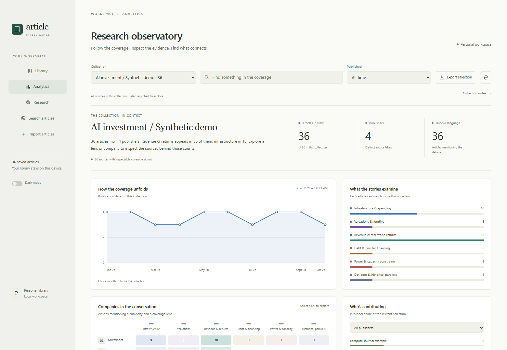
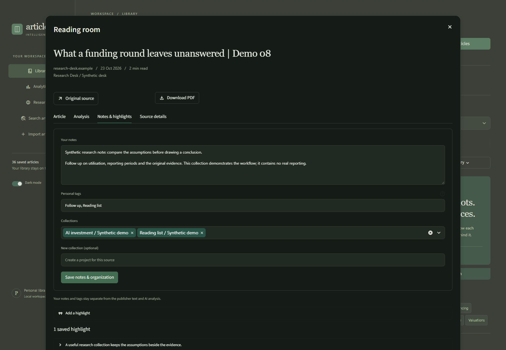

# Article Intelligence

A local research workspace for collecting articles, comparing coverage, and returning to the evidence. Save reading copies, organize your notes, explore a collection, and optionally ask a local model questions with passage citations.

Built with Python, Streamlit, SQLite, Playwright, and Ollama. Intended for personal research on your own machine.



## What you can do

- **Build a library.** Import public article URLs, keep a separate PDF for each article, and search saved text with indexed filters and pagination.
- **Discover sources.** Search recent news by topic, keywords, publisher, date, and language; preview results before importing a selection.
- **Compare coverage.** Explore linked timelines, publishers, companies, and six inspectable AI investment coverage themes. Every count leads back to saved sources.
- **Keep your own research.** Add notes, personal tags, project collections, and highlights anchored to a particular text revision.
- **Use local AI when you need it.** Generate cited summaries and takeaways, search semantically, and ask questions across saved articles through Ollama.
- **Take your work with you.** Export filtered metadata, download reading PDFs, or back up and restore the library with annotations and saved analyses.

Library search, reading, notes, exports, and coverage analytics work without a running model. Themes support light and dark appearances.



## Run locally

The validated development environment is **Windows, PowerShell, and Python 3.13**. Run these commands from the folder containing `app/`, `README.md`, and `requirements.txt`:

```powershell
py -3.13 -m venv .venv
.\.venv\Scripts\python.exe -m pip install -r requirements.txt
.\.venv\Scripts\python.exe -m streamlit run app/dashboard.py
```

Open **http://localhost:8501**. A fresh checkout starts with an empty library. Import a few public article URLs to begin, or try the synthetic demo below. Virtual environment activation is optional; the commands above work without changing PowerShell's execution policy.

Auto capture tries normal HTML first, then a bounded browser session for incomplete JavaScript pages. If Chrome or Edge is unavailable, install Chromium:

```powershell
.\.venv\Scripts\python.exe -m playwright install chromium
```

For optional AI features, install and start [Ollama](https://ollama.com/), then pull the default models:

```powershell
ollama pull qwen3:8b
ollama pull qwen3-embedding:0.6b
```

Model inference runs locally; performance depends on your hardware. Model selection and connection settings are in **Research**. See the [operating guide](docs/usage.md) for capture options, search behavior, model configuration, backups, and CLI usage. Other operating systems need clean-install validation before being declared supported.

## Try the synthetic demo

The screenshots use **36 fictional articles from four fictional publishers**. No publisher article text or personal library is distributed. Example analyses are hand-authored fixtures, not evidence of model quality. The generator makes no network or model calls and refuses to write into a nonempty destination.

```powershell
.\.venv\Scripts\python.exe scripts/seed_demo.py
$env:ARTICLE_LIBRARY_DB = "$PWD/output/demo/library.db"
$env:ARTICLE_PDF_DIR = "$PWD/output/demo/pdfs"
.\.venv\Scripts\python.exe -m streamlit run app/dashboard.py
```

Stop Streamlit with Ctrl+C. Before opening your normal library in the same terminal, clear the two overrides:

```powershell
Remove-Item Env:ARTICLE_LIBRARY_DB, Env:ARTICLE_PDF_DIR
```

The default library is `data/articles.db`; reading PDFs live in `output/pdfs/`. Both directories are ignored by Git. To make another demo, use `--output output/demo-2` and update the two overrides to match.



## Development and checks

```powershell
.\.venv\Scripts\python.exe -m pip install -r requirements-dev.txt
.\.venv\Scripts\python.exe -m pip check
.\.venv\Scripts\python.exe -m pytest -q
```

The default suite uses offline fixtures; one browser test is opt-in. To run that test too with installed Chrome/Edge/Chromium:

```powershell
$env:RUN_BROWSER_TESTS = '1'
.\.venv\Scripts\python.exe -m pytest -q
Remove-Item Env:RUN_BROWSER_TESTS
```

[GitHub Actions](.github/workflows/tests.yml) installs Chromium and runs the full suite on Windows/Python 3.13 for pushes and pull requests. Its first hosted run happens after you push. `requirements.txt` pins direct runtime dependencies; `requirements-lock.txt` records the tested development environment.

## Scope and limitations

This is a local research MVP. Authentication, shared workspaces, cloud deployment hardening, and a durable general-purpose ingestion queue remain future work. Free news discovery depends on provider availability and terms; search result counts are requests, not guarantees of available or importable articles.

Captures can be incomplete, blocked, or missing metadata. Capture diagnostics flag possible issues for review; they do not establish factual accuracy. The existing 100-source diagnostic cohort does **not** establish the planned 90% extraction completeness target. AI answers and summaries also need checking against their cited passages.

Coverage analytics currently use English keyword rules and company aliases. These are text mentions, not sentiment scores or verified financial relationships. Discovery language filters do not make the analytics multilingual. PDFs are text reading copies, not faithful page archives or OCR. Images remain references.

Use sources you are authorized to access and reproduce. Capture respects robots checks and does not bypass sign-in or paywalls. Keep the server bound to localhost; this application has not been hardened for an untrusted multi-user deployment.

## Project documentation

- [Operating guide](docs/usage.md): detailed workflows and configuration.
- [Architecture](architecture.md): data flow, storage, trust boundaries, and planned evolution.
- [Requirements](requirements.md): product scope and acceptance criteria.
- [Milestones](milestones.md): completed work, historical measurements, and outstanding validation.
- [Publishing guide](docs/publishing.md): review and push your local repository.

## License

[MIT](LICENSE) for this project's code and original synthetic fixtures. Third-party dependencies and publisher content retain their own licenses and rights.
