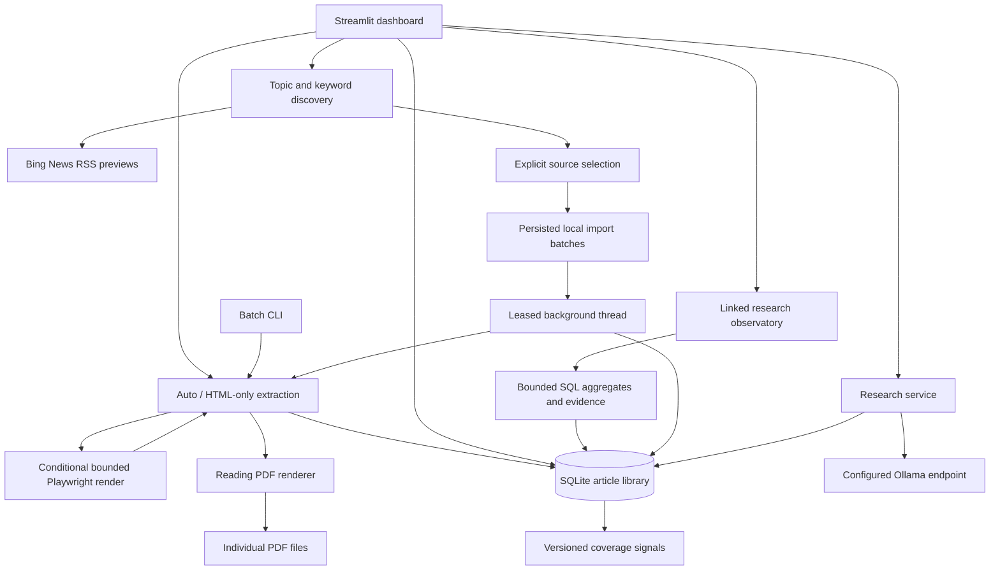

# Architecture

Updated: 2026-11-02. Scope: local, single-user research application.

## Current system

Capture applies `article_cleanup.py` before normal or browser-rendered HTML reaches Trafilatura. A narrow, link-aware rule removes complete publisher-home/news and social/newsletter promotion blocks matching the supported template. It checks the publisher homepage and multiple social/newsletter links where applicable, preserves quotations, structural containers and mixed editorial text, and never cuts off the remainder of an article. Removed nodes also leave the captured link list. Capture diagnostics use the same cleanup against the original DOM reference and record the rule version/block count, so intentionally omitted promotions do not look like missing body paragraphs. Minimum body length is checked after removal. This is targeted boilerplate handling, not a claim of general extraction completeness; existing saved text/PDFs and frozen evidence are unchanged.

Extraction evaluation now fingerprints the cleanup dependency alongside extractor/diagnostic code, binds it into new review evidence, and refuses same-phase resume or frozen-engine replay with incompatible dependency versions. Historical report/review files remain untouched.

Research usability is separated from inference: `model_health.py` performs bounded GET-only inventory/runtime/residency checks on explicit request, with unknown/unloaded states and no model startup. It imports only the existing checked runtime floor and does not change `OllamaClient.generate`, embeddings or retrieval. The UI scopes stored diagnostic snapshots to endpoint/selected models and clears them on inventory refresh. A semantic HTML table uses the app's theme variables rather than a fixed-light canvas, escapes model text and supports keyboard/horizontal scrolling. The optional `check_install.py --ollama` path reuses these checks without opening personal storage; the default installation check remains model-service independent.

`research_export.py` serializes the existing in-session result into a versioned complete JSON snapshot and a readable Markdown brief with numbered citations/exact cited passages. It verifies reference identity and safe source links and renders untrusted text as literal Markdown. Search/abstention results retain their distinct meaning. Markdown URLs convert international hostnames to IDNA and encode paths while preserving explicit ports/IPv6; JSON retains the original URL. Download controls avoid a research rerun; exports write no app records and are separate from planned durable research sessions. No retrieval, prompt, context, cache or default-model change accompanies these UI/diagnostic/export features.

The research UI replaces its last completed result only after a successful request. A failed attempt stores a separate scope-bound error; changing models/filters, offline inventory or an empty source list cannot hide the previous answer/export. Results with a different current scope are explicitly labelled. New result metadata records UTC completion time, selected and actually loaded source IDs, their existing source fingerprints, library revision, mode, embedding model and applicable generation-context policy. Retained passage copies are presented/exported unchanged, never added to subsequent retrieval. Explicit clearing removes only result/error session keys; it performs no storage mutation. This is single-result session retention, not persistent history.

Developer review supports both a case editor and a consolidated batch page. `prepare-batch-review` validates a complete AI-suggestions file against the original corpus/case hashes, immutable identity/scope/labels, eligibility and exact source spans before writing a new packet. The overview groups proposals by story family and includes each full source copy once. Original/proposed changes, concrete facts, exact evidence and issue flags remain inspectable; AI suggestions are separate from the standard human-review JSON.

The batch page starts with no selections or decisions. Explicit user actions record selected unchanged proposals as accepted, changed ones as revised, or exclusions with reasons. Flagged and proposed-unanswerable cases require full-scope/capture confirmation. Source-family attestation remains separate. Pending edits and partial decisions can be downloaded/imported without any remote service or autosave. Existing `apply-gold-review` performs authoritative validation and writes a new corpus only after all required human declarations are complete. Batch authoring does not modify production RAG, certify human independence or establish a quality score.

Generation uses policy `adaptive-8k-16k-v1` in `OllamaClient.generate`. A UTF-8 byte/3 estimate covers the system message, complete user prompt and appended JSON schema; it is not exact tokenization. The client reserves 1,600 output tokens and 512 tokens for template/estimation headroom, selecting 8,192 or 16,384 context tokens. Ollama 0.40.11 is the oldest checked runtime for `truncate=false` and `shift=false`; generation refuses older/unidentifiable versions rather than assuming those controls work. Embedding search and saved insights do not require this generation check.

If the 8K server request exceeds context, or its returned `prompt_eval_count` leaves insufficient reserved output space, the client retries the identical messages/schema at 16K. There are at most two generation attempts. A 16K overflow or insufficient answer space raises an actionable error without saving the response; connection, model-load, citation-validation and output-token-limit failures are not blindly retried. Input evidence is not removed to make the new window fit. Existing article analysis still discloses its separate 18,000-character source cap. Context changes can reload the model and add latency.

Generation metadata records the policy, estimate, reserves, chosen window, reported token counts and per-attempt context outcomes. New saved analyses, research results and evaluator rows retain this metadata; UI captions show the actual selected context. Session reuse includes the policy version. Existing saved analyses are retained without regeneration. Evaluation snapshots preserve the earlier fixed-16K engine for comparison; automatic context selection is a new candidate configuration, not proof of unchanged answer quality. The model default, retrieval ranking, six-passage budget, schema and output-token limit remain unchanged.

The research evaluator is a separate developer CLI that calls the existing `semantic_search` and `answer_question` functions without changing app behavior. Its versioned corpus uses original-text hashes, character spans, sufficient evidence alternatives, source/capture provenance, story families and human/synthetic/pending label declarations. Every run snapshots its corpus, pipeline/harness code, configuration/model identities and actual request settings; embedding writes go to a disposable SQLite database rather than the configured personal library. Completed observations are flushed to a JSONL journal; interrupted runs do not get a final certified report and have no automatic resume.

The native Windows NVIDIA launcher accepts `-KvCacheType f16|q8_0`, defaulting to `f16`. Cache quantization is explicit, server-wide and independent of the app's model selector/context policy; a requested profile is not proof of actual backend behavior. A local `profile.json` records only allowlisted requested settings and the started PID; runner logs establish actual K/V types and offload. The launcher preserves parent/persistent environment settings, refuses occupied ports and never stops existing processes. Cache/model experiments retain separate frozen runs and pending review packets rather than silently changing the default model or calling a GPU placement result a quality improvement.

Development authoring is a preceding, separate step: an explicit source/group selection is copied from a read-only SQLite transaction without application migrations, model prompts use bounded sampled original anchors, and every question/fact/absence decision is initially unreviewed. Remaining source metadata is unassigned, not automatically independent held-out material. The self-contained HTML gold-review page uses literal source text, exact Unicode span selection, light/dark/mobile layouts and download/import of review JSON without network requests. Applying decisions validates source/case hashes, complete human declarations, scope, spans, revisions/exclusions and optional independent-review agreement before writing a new corpus. It never updates the application library or certifies model quality.

Retrieval diagnostics use top-10; answer diagnostics retain the app's six-passage context and leave @10 unmeasured. Span mapping verifies the current chunker exactly; later inspection/paired comparison validates the saved source spans independently of the current chunker. Failures, exclusions, source/tag strata and story-clustered uncertainty remain explicit. Human review decomposes generated claims into atomic units, separately judges cited support and required-fact coverage, and binds labels to canonical run/claim hashes. Reviewers are declared identities, not authenticated people. The fixture engine and original 24-case corpus test machinery without representing model quality. This is not product-level saved research/session persistence or a new production RAG pipeline.

Analytics adds bounded SQL aggregates for adjacent 30-day publication windows, recorded authors, current saved labels and current-version capture-check/flag counts. Publisher aggregates include analyzed counts and latest publication date; leading/top-three shares use counts over the entire filtered selection. A six-topic/five-publisher comparison counts distinct source IDs and reports topic reach across all matching publishers. Duplicate labels do not multiply counts, and stale model/version/content analyses contribute no labels. Queries reuse the notebook/export predicates and load no additional source bodies. All aggregates share one read transaction; only 12 source excerpts are returned per page. The component uses literal text, native buttons, semantic tables/definition lists, theme variables, reduced-motion handling and contained horizontal scrolling. Selection of a comparison cell commits both topic and publisher in one update. Missing checks/labels and zero prior periods remain explicit; these are no ownership, bias, truth or claim-comparison scores. Analytics cache keys include calendar day alongside database path, revision and filters so date-based indicators refresh without a library mutation.

Analytics defaults to a general collection view rather than an AI-bubble collection or investment taxonomy. The existing revision-cached SQL snapshot computes current-analysis coverage, distinct-source topic counts, word/reading-length totals, publishers and bounded publication activity. Date spans of at most 45 days use zero-filled daily bins; longer spans retain at most 60 zero-filled months. Topic/status/day filters share the list/export predicates. Investment lenses, company aliases and concern/countercase excerpts are computed only in the explicit specialist view. General mode displays no investment tags or argument cards. Topic labels come from current default-model analyses, not new model calls or assumed topic classifications.

An empty reading-room Analysis tab hands one article ID to a focused Research view, preserving unrelated Library/Research filters. Missing/deleted sources and offline models produce actionable states; navigation starts no model job. Shared pagination uses a compact Previous/page-jump/Next group that wraps on small screens. A bounded Markdown-to-text preview removes image references and destinations without changing stored text, PDFs or extraction fingerprints.

Embedding cache reads batch up to 256 hashes per SQL statement. The embedding model stays loaded for up to one minute between 16-input batches; the final batch requests unload before chat generation. Inputs, vector values, cosine ranking, six-passage retrieval and output budget remain unchanged. Generation context follows the adaptive policy above. Research reports reuse/creation counts and elapsed time. Only the last identical question/mode/source-revision/model/endpoint/context-policy result may be reused in session memory, with an explicit fresh-result bypass; this is not durable saved research or an answer-quality evaluation.

The public repository contains application code, tests, documentation and original synthetic demo fixtures. Runtime libraries, publisher captures, PDFs, evaluation caches and backups live under ignored `data/` and `output/` directories. `scripts/seed_demo.py` creates a separate demo library in a new or empty destination, without fetching sources or running a model; its storage overrides are restored when the generator finishes. Public screenshots come from that isolated library.

The GitHub Actions workflow defines Windows/Python 3.13, Ubuntu/Python 3.13 and disposable Docker validation. The expanded jobs await an authorized push; local results are recorded in [validation](docs/validation.md). This is application validation, not deployment or evidence of hosted multi-user readiness. Direct dependencies and the Linux runtime resolution are pinned; action revisions and Python/browser image manifests are pinned to release commits/digests.

The runtime image keeps the existing Streamlit/services/SQLite architecture. `ARTICLE_LIBRARY_DB` and `ARTICLE_PDF_DIR` point at two isolated named volumes. Compose publishes only host loopback, runs UID 10001 with all host capabilities dropped, read-only rootfs, no-new-privileges and the documented seccomp profile. Chromium assets match the Python Playwright version; the launcher explicitly enables sandboxing and never falls back without it. A marked profile rule permits namespace-local `chroot` without granting the corresponding host capability. Native URL/robots/redirect/resource policies are unchanged. Schema version 6 is retained; no storage migration was needed for packaging.

Read-only installation diagnostics, an isolated search/PDF/restore smoke, disposable native server validation and a random-project container validator reuse existing services. They introduce no alternate CLI persistence layer or job queue. The container validator checks port bindings/volume ownership, actual browser sandbox status, recreation persistence and live UI/PDF behaviour, then removes only its own test project. The Docker test target includes existing evaluator fixtures; development packages/test data do not enter the runtime image.

The dashboard and CLI call Python service functions directly. Ingestion fetches HTML, extracts body/metadata, generates a PDF, then upserts the article. PDF generation and the database commit are currently separate operations; atomic PDF replacement protects a previous file, but there is no transaction spanning the filesystem and SQLite.

| Module | Responsibility |
| --- | --- |
| `app/dashboard.py` | Streamlit entry point and session-based workspace routing |
| `app/ui.py`, `app/assets/dashboard.css`, `.streamlit/config.toml` | Shared components, system typography, warm light palette, and responsive styling |
| `app/theme.py` | Semantic light/dark palettes, session-scoped appearance, URL restoration, and chart colors |
| `app/library_view.py` | Indexed keyword/publisher/status queries, bounded article pages, reading dialog, and export controls |
| `app/library_filters.py` | Full-width library controls, durable filter values, shared query/export predicates, date and reading-length semantics |
| `app/text_preview.py` | Bounded plain-text previews for Library/Analytics; removes image/destination markup without fetching resources or modifying source copies |
| `app/library_actions.py` | Personal annotations, normalized tags, collection editing, source anchors, managed file policy and journaled single-article deletion |
| `app/annotation_view.py` | Reader note/tag/project forms, highlight creation/editing, bounded highlight pages and outdated-anchor notices |
| `app/library_backup.py`, `app/backup_view.py` | Versioned portable JSON/ZIP snapshots, strict archive validation, merge preview and non-overwriting restore |
| `app/analytics_view.py`, `app/observatory_view.py` | Analytics routing, revision-keyed snapshot cache, trusted v2 component registration, reading/export actions |
| `app/observatory_data.py` | General topic/status/reading-profile aggregates and daily/monthly activity; optional investment co-mentions/evidence; matching bounded source/export scope |
| `app/facets.py` | Versioned, inspectable English lens/company/passage matching; no sentiment or fact-check claims |
| `app/assets/observatory.*` | Static trusted markup, palette-aware CSS, responsive SVG, linked controls, cancellable animation and reduced motion |
| `app/exports.py` | Metadata-only CSV streaming into a bounded buffer and current-page PDF ZIP limits |
| `app/ingest_view.py` | URL import form and persistent per-import results |
| `app/discovery.py` | Bounded RSS search, quoted provider queries, domain/date/keyword checks, canonical display URLs, deduplication, safe highlights |
| `app/discovery_view.py` | Persistent search form/results/selection, previews, explicit collection imports, polled activity |
| `app/discovery_imports.py` | SQLite batch/item states, lease claims, background worker, existing-URL reuse, cancellation and transactional article/item completion |
| `app/ai_dashboard.py` | Model selection, saved insights, source inspection, and research UI |
| `app/extract.py` | URL validation, fetching, robots policy, metadata/body extraction |
| `app/browser_render.py` | Anonymous headless rendering, intercepted resource transport, fail-closed direct networking, visible DOM snapshots and resource budgets |
| `app/capture_quality.py` | Stable failure categories/actions, bounded explicit metadata parsing, Unicode text units, versioned capture findings and stored-check decoding |
| `scripts/evaluate_extraction.py` | Frozen cohorts, local HTTP-response/reading caches, paired diagnostics, resumable reports, reviewer accounting and release-gate separation |
| `scripts/evaluate_research.py`, `scripts/research_eval/` | Versioned research corpus/schema, source-span metrics, isolated baseline runs, immutable code/evidence snapshots, human review packets and paired diagnostics |
| `app/reports.py` | PDF metadata, source reference, pagination, and atomic output replacement |
| `app/pdf_content.py` | Markdown tokens to safe ReportLab reading content; no network access |
| `app/storage.py` | Versioned migration/backup, FTS5 maintenance, bounded library queries, aggregates, insight/embedding caching |
| `app/intelligence.py` | Ollama contracts, passage construction, summaries, retrieval, cited answers |
| `cli.py` | Synchronous URL-file ingestion |
| `scripts/collect_ai_bubble.py` | Public-source collection with shuffled host buckets, quotas, duplicate/quality checks, incremental audit and resume |

## Data and output contracts

- `articles`: stable article ID, unique final URL, metadata, extracted text, link/image references, PDF path, `fetch_method` (`html` / `browser`) and bounded `quality_json`. Capture method and diagnostics are excluded from content fingerprints.
- `article_insights`: one cached result per article/model, checked against a content fingerprint and analysis version.
- `embeddings`: model-name/text-hash cache storing vectors as JSON.
- `research_collections` and `collection_articles`: named research questions and article memberships, with foreign-key cascade on membership deletion.
- `article_notes`, `article_tags`, `article_highlights`: personal text, Unicode-normalized tag keys/labels and exact quote/offset/text-hash anchors. Article foreign keys cascade on deletion; mutations advance the library revision without changing source fingerprints.
- `pending_pdf_deletions`: internally generated operation IDs and managed filenames for deletion recovery. This journal is not imported from portable archives.
- `article_facets`: article/content fingerprint/rule version and JSON lens IDs, company aliases, matched passage previews, and bubble-language flag. Upserts refresh changed signals in the article transaction. Queries exclude stale content/rule versions.
- `import_batches` and `import_batch_items`: collection/query identity, queued/running/completed/failed/cancelled batch states, per-URL queued/running/saved/existing/failed/cancelled outcomes, owner/lease, stop request and bounded error text. Schema version 3 adds these after a consistent backup; existing articles, FTS, insights and vectors are retained.
- `articles_fts`: external-content FTS5 index over title, author, normalized publisher, and text, maintained by insert/update/delete triggers. Search input is translated to literal Unicode word-prefix terms, combined with AND; raw FTS operators are not accepted.
- `articles.content_hash` and `publisher_key`: derived values maintained by application upserts. Insight queries join on article/model/version/content hash, so stale results do not count as current.
- `library_state`: mutation revision used to invalidate prepared exports and research state after article/analysis changes.
- `data/articles.db`: local persistent database. Runtime PDF paths are absolute; portable backups omit them and use relative `pdfs/<id>.pdf` entries, rebased to the destination's configured managed PDF folder.
- `output/pdfs/<article_id>.pdf`: generated reading copy; PDF regeneration uses saved text and makes no publisher requests.
- Images remain references. The PDF renderer emits an alt-text placeholder when Markdown image syntax is present and never fetches the image.

PDF content uses a CommonMark parser with the table extension. Only renderer-generated ReportLab formatting is interpreted. Raw HTML is escaped. Link annotations allow HTTP(S) destinations without embedded credentials; relative destinations are resolved against the article URL. This is an output-link policy, not a network-fetch authorization. Built-in PDF fonts still limit multilingual coverage. Original website layout or structure discarded by extraction cannot be recovered by PDF formatting.

## Current limits

- Manual URL ingestion and model analysis can hold the active Streamlit interaction until completion. Explicitly selected discovery imports run in the background.
- Library pages return at most 100 metadata/excerpt/insight rows (25 by default). SQLite computes totals, matching counts, and up to 100 common topic labels. Publisher choices are metadata only. Sorting and filters run in SQL with stable ID tie-breakers. OFFSET pagination and aggregate scans still grow with collection size; 10,000 synthetic articles were measured, not unlimited scale.
- Library/Analytics plain-text previews parse at most 2,400 source characters per row and return at most 240 characters, including any ellipsis. Reading copies and PDF/source fingerprints retain the original saved text.
- Analytics applies the same collection/keyword/date/publisher/topic/status/day/month predicates to general totals, charts, source rows and CSV. The explicit investment view adds lens/company filtering, six lenses, seven displayed company rows and two passages per argument type. General mode shows at most eight topic labels; both modes show eight publisher bars, 12 source rows, at most 46 daily bins or 60 monthly bins including zeros. Publisher controls list all labels in the collection. Topic/lens counts can overlap; co-mentions do not establish financial links. Previews use at most 2,400 source characters per row, without whole-article payloads.
- Semantic search still reconstructs passages, reads JSON vectors, and scores every passage in its scope; it returns at most six passages. Research browsing is paginated and questions are explicitly limited to the shown/selected sources, at most 100 articles. Whole-library semantic retrieval and background indexing remain M4/M5 work.
- Summaries analyze a prefix of up to 18,000 source-text characters; omitted passages are labeled as partial coverage.
- Citation validation checks passage identity and response shape, not whether each assertion is supported.
- Model names are cache keys, but a mutable model tag can change underneath the name. Content revisions also change positional passage IDs. Persistent research must store immutable evidence snapshots and model identity.
- Robots and article traffic share public-URL and redirect validation, finite hop limits, connection/read timeouts, streamed size limits (256 KB robots / 5 MB HTML), a response time-budget check, and per-host pacing. Robots policies are cached for ten minutes; failed/unverifiable policies are not silently allowed. Public hosting still needs complete DNS-rebinding/egress protection.
- Schema version 6 is applied under a write reservation with a consistent pre-upgrade SQLite backup and transactional DDL/backfill. Version-1 databases retain their FTS index and insight/embedding caches while adding collections/facets; version-2 databases add import queues without rebuilding those objects. Version 4 adds capture method/mode, version 5 adds capture checks and failure codes, and version 6 adds personal annotations, indexes, revision triggers and the deletion journal. Existing source fingerprints and cached AI records are preserved. Connections check `user_version` and close deterministically; newer databases are rejected. Portable merge restore is delivered; general cross-process recovery remains M5 work.
- Exports are explicit: metadata CSV for filtered results has a 25 MB cap; PDF ZIPs include only the current page (up to 100 files / 50 MB actual input). Native Streamlit downloads still buffer data, so these are bounded batch exports rather than a streaming large-file HTTP service.

## Personal organization, deletion and portable recovery

The reading dialog loads fresh article/annotation state for each interaction and refreshes Library on
dismissal. Note/tag/membership edits commit together. New named collections can serve as projects;
global collection rename/delete is outside this first scope. Tags normalize Unicode/whitespace and use
case-folded keys, with up to 20 labels of 40 characters. Library predicates use indexed tag membership;
counts, bounded pages and CSV share that predicate. Article pages load tag labels for only their bounded
IDs. Personal notes are not added to source FTS or model evidence.

Highlights keep the exact quote, character offsets and SHA-256 of saved source text. A repeated quote
has an explicit occurrence. Metadata-only changes preserve anchors; any source-text change marks them
outdated without automatic relocation. Current anchors map to escaped Markdown text/code tokens for
reading highlights where possible; the saved quote remains inspectable even without a rendered map.
At most 200 highlights are stored per article and ten editors appear per page. Notes are bounded at
20,000 characters, quotes at 3–5,000 and highlight notes at 5,000. Native labels escape Markdown image
syntax, and annotations never modify the publisher text, PDF or AI fingerprint.

Deletion requires a concrete reader confirmation and idle import batches. A write reservation verifies
the article, then an internal journal records an exact managed filename and unique staging name. Only
the canonical, unshared managed `<id>.pdf` can be moved; outside/symlink/shared references are kept.
The article transaction deletes its insights, article row, cascaded annotations/facets/memberships and
FTS entry. Caught failure restores the staged PDF; startup/reruns reconcile journaled operations.
Locked or conflicting files remain pending. Shared content-addressed embedding vectors are retained
because the current cache has no per-article ownership map; removal prevents them from becoming source
evidence because retrieval still requires live article text. A local reentrant file lock coordinates
deletion/recovery, portable operations and manual PDF/database commits within this app process.

Portable backup version 1 contains allowlisted JSON tables and available managed PDFs, not executable
SQL or a serialized Python object. It includes source data, annotations, collections, insights and
cached vectors; import jobs, derived FTS/facets and deletion journals are rebuilt or excluded. Snapshot
creation reserves database writes, requires idle import batches and holds the local file lock while
packing. PDF entries carry byte counts and SHA-256 checksums. Outside/missing/invalid PDF copies are
reported, and article text remains included. Archives are bounded to 10,000 articles, 128 MB metadata,
20 MB per PDF, 250 MB compressed/512 MB expanded data and section-specific record caps.

Inspection rejects malformed/duplicate JSON, invalid fields/references/vectors/analysis, unknown
formats, unsafe/duplicate/linked archive paths, oversized entries and PDF checksum/format mismatches.
No `extractall`, SQL from the archive, pickle or publisher/model requests are used. Portable IDs reject
Windows device names and must be unique without case to avoid filename aliases. Inspection previews new/existing/changed
source counts; execution revalidates the archive and current database before writing.

Restore preserves existing source text and nonempty notes. Exact-URL identities map to existing IDs;
annotations merge only for matching saved text. Analysis passage IDs are never silently rebased to a
different article ID. Duplicate anchors/tags/cache entries are ignored; changed collection identities
receive a deterministic restored ID. Managed PDF paths rebase to the configured destination; existing
files are kept, conflicting unrelated files block the operation, and matching orphan files may be
adopted after integrity checks. New PDFs stage in the destination directory and use exclusive hard-link
creation before the SQLite commit. Caught failures roll back new rows and remove only files created by
that attempt. Sudden process loss may leave staging/orphan files; complete cross-process crash-proof
coordination remains M5 work. Restore therefore requires a filesystem supporting hard links.

Verification covers source/annotation/analysis/vector/PDF round trips into another database and folder,
repeat merge, conflicting identities/files, active-import guards, deletion rollback/recovery and safe
rendering. The real 105-article library was also restored into isolated storage with all 105 PDF hashes,
five analyses, 28 vectors and collection memberships preserved. Original records remain unchanged.

## Capture quality and evaluation

`extract_document` separates parsing an already policy-checked HTML response from fetching, enabling
offline replay without weakening the network policy. HTML-only replay never starts a browser. Body
extraction excludes comments and requires 80 estimated reading units; Unicode tokenization counts CJK
characters individually. `word_count` on new captures uses this estimate. Existing records are unchanged.

Bounded HTML meta and article JSON-LD parsers fill missing title/author fields and prefer explicit
`datePublished`/published-time metadata over heuristic dates. They do not use JSON `articleBody` as a
metadata fallback. Normalized dates retain the metadata's calendar date; time-zone boundaries and source
errors still require review. Metadata provenance is recorded with the capture checks.

Diagnostics version 2 records readable units, detected reference kind, substantial source-block counts,
and approximate anchor coverage. Paragraphs, list items, table rows, preformatted blocks and quotations
are included without counting nested blocks twice. Missing dates, suspiciously low coverage, excessive
text relative to the detected region and decoding damage can require review. Missing authors are
informational. These rules can be wrong, particularly for div-based, dynamic or multi-section pages.
`checks_passed` means no warning-level automated findings, never independent body verification.

If excessive text is detected and exactly one explicit article/body region exists, the extractor compares
a scoped precision extraction. It accepts the shorter version only with at least 80 units, retained
detected-block coverage (at least 85%, within two points of the original), and a substantial length
reduction. It does not globally enable precision mode or shared cross-document deduplication.

New checks persist in the article transaction. Legacy copies remain unassessed. Manual import results,
background batch counts and reader/source details expose warnings; failed items retain stable error
codes and actionable explanations. Annotation-only changes preserve AI content fingerprints.

The evaluator freezes URL identities and hashes before changes, bounds publisher concurrency to four,
uses the existing robots/HTTP policy, and keeps a local-only cache capped at 128 MB. Original publisher
HTML and reading text are not redistributable test fixtures. Offline comparison uses the same response
hashes, keeps uncached live failures explicitly unreplayed, and records extractor/diagnostic identities.
An editable CSV separates eligibility, body/title/metadata/boilerplate checks and reviewer attribution.
No reviewed pass rate is reported without completed review rows; the M2 gate additionally needs at
least 100 eligible reviewed sources, 10 hosts and 90% passing. The current 100-source convenience cohort
does not satisfy that gate. Reports and a review checklist are under `output/evaluations/ai-bubble-20261028/`.

## Auto article capture

Manual imports, selected discovery batches and the CLI default to Auto; each also supports HTML only.
`extract_article` runs bounded HTML fetching and gate checks first. Only a successful HTML response
with an absent/short extracted body and script/shell indicators may invoke Playwright. Robots denials,
network failures, HTTP blocks, size failures and recognized subscription/sign-in/challenge pages fail
without browser retry. These heuristics do not establish complete paywall or body-quality detection.

Playwright launches installed Chrome/Edge or bundled Chromium in a fresh headless context. Windows
workers use their own subprocess-capable asyncio loop without replacing Streamlit's global loop policy.
The first document uses the already-fetched HTML. Allowed GET documents/scripts/stylesheets/fetch/XHR
are fulfilled through streamed Python transport with public-address validation. An unusable context
proxy closes any path around interception. Resource redirects are followed in the validated transport,
never emitted as browser redirects; redirected browser documents fail with a final-URL instruction.
Ordinary initial HTTP redirects still follow the existing validated HTML path.

One render has a 40-second deadline after navigation policy checks, with bounded browser cleanup and
in-flight network reads. Limits are 60 requests (including resource redirect hops), 12 hosts, five
navigation/redirect hops, two concurrent resources, 5 MB documents, 2 MB other resources, and 15 MB
aggregate response bodies. Images/fonts/media, subframes, non-GET requests, downloads, service workers,
WebSockets and popups are disabled. There is no sign-in, cookie-profile reuse, form submission,
challenge solving, scrolling crawler or recursive discovery. Stylesheets load to determine visibility;
the saved DOM snapshot removes hidden nodes, scripts, forms and executable/JSON article payloads while
retaining ordinary metadata and visible references. Gate detection runs again before capture.

Browser dependencies and channels are documented in README. Batch `fetch_mode` is fixed when queued
and retained through lease recovery; exact existing URLs still reuse their saved article. Source details
shows the persisted capture method. Browser fixture success is separate from live publisher coverage;
M2 still requires reviewed body/metadata evaluation and stronger deployment network controls.

## Discovery and selected-source imports

The first discovery provider is the public Bing News RSS endpoint, used only for personal, non-commercial aggregation. Search metadata stays in the local Streamlit session/ten-minute bounded cache; previews are not inserted into `articles`. The service quotes user topics rather than exposing provider operators, caps targets at 100, response bodies at 2 MB, pagination at 20 calls, and the search-loop budget at 60 seconds before starting another page. Each network call has connection/read and streamed-response budgets; the final in-flight call may extend the loop budget. Requests are paced at one per second. HTTP blocks, rate limits and malformed feeds become actionable errors; partial successful results are retained. Duplicate URLs and same-publisher titles are removed. Feed redirect wrappers are unwrapped locally from their publisher URL parameter. Unsafe display schemes/credentials/private literal addresses are rejected, and the existing full public-network/redirect/robots policy runs again during import.

Publisher domains, reported local publication dates and required title/preview keywords are checked locally. Feed language is requested from the provider, not independently detected; publication dates and body completeness are not established by discovery. Any-match topics and keyword matching/highlighting have distinct controls. All highlighted text is escaped before app-owned `mark` elements are added. RSS XML with DTD/entity declarations is rejected. A licensed provider adapter and language/content validation remain future work; the RSS provider is not suitable as the hosted commercial backend.

Selected imports create or extend a named collection for the same topic query. A local daemon worker claims queued or expired-running batches under a SQLite write reservation. Its five-minute owner lease is renewed between items; expired running items return to the queue on recovery. Work is bounded to 100 URLs per batch, and ordinary extraction failures are recorded without automatic retry loops. The worker uses no Streamlit APIs. Network fetch/PDF generation happen outside database transactions; article upsert, collection membership and item completion commit together after checking ownership. PDFs still use separate atomic filesystem replacement, so there is no filesystem/SQLite transaction. Exact saved URLs are reused. Text under 80 or over 30,000 extracted words is rejected as an excerpt or out-of-scope long report. These checks do not establish independently reviewed extraction completeness.

A two-second Streamlit fragment polls up to five recent batches. A stop request completes the current article and marks remaining queued items cancelled. Batch metadata survives page navigation and process restart; recovery can wait up to the lease interval. Jobs are local and single-user; a full scheduler, automatic bounded retry policy, analysis/index jobs, multiple-user ownership and release-grade restore remain M5 work. `ARTICLE_LIBRARY_DB` plus `ARTICLE_PDF_DIR` isolate both database and generated PDFs for live browser QA.

## Contextual filters and review tooling

Filter option queries reuse `_library_query` for current model/version/content hash, collection, keyword and metadata predicates. They aggregate bounded topic/tag/coverage choices over all matching IDs without loading article bodies into the UI. Topic/tag selections are omitted only when deriving their own alternatives; result/export predicates include them. Research and Library prune stale values and retain compatible controls across navigation. AI investment-specific Library filters are opt-in and remain separately labelled.

The existing extraction evaluator now supports protocol-backed candidate manifests and a separate phase-bound review workflow. It verifies manifest/configuration, source metadata/body hashes and available reading-copy bytes before counting labels. Existing capture phases and legacy checklists remain intact; review summaries are separate metadata artifacts. Pending/excluded/failed cases remain visible, second-review disagreements block the cohort gate, and descriptive binomial intervals are explicitly not publisher-cluster-aware or evidence of general-web quality.

## Planned evolution

The workspace now defaults to a searchable Library, with separate Analytics, Research, Search articles and Import views. Model discovery is deferred until Research opens. Saved summaries are available both in Research and in each article's reading dialog. The reading renderer uses HTML-disabled CommonMark rather than Streamlit math parsing, preserves extracted paragraph breaks, and disables image rendering to avoid external image requests. Native Streamlit controls retain keyboard interactions; CSS targets stable test IDs and named containers rather than generated class hashes.

The sidebar appearance switch stores `dark_mode` in session state and writes the validated `theme=light|dark` choice to the page URL for refresh/new-session restoration. It never mutates process-global theme configuration. `app/theme.py` supplies both shell CSS and the isolated analytics component palette. Native/portalled controls, dialogs, code panels, and reader content share those variables. Theme changes preserve analytics filters and do not modify stored content, caches, or exported PDF styling.

Library pagination keeps a durable view page separately from the temporary numeric widget value. View entry initializes missing page state even when the filter scope is unchanged; the numeric input synchronizes through a callback. This prevents Streamlit widget cleanup on navigation from producing a missing `library_page` error. Library controls use native session persistence and a saved control snapshot, including optional date fields; the expanded panel keeps a stable label so applying a filter does not close it. Counts, pages, and CSV receive the same normalized predicates. Reading-length bands use 220 words/minute: at most 1,100 words, 1,101–3,300, or over 3,300. Custom date bounds can be open-ended; reversed dates show a warning, and all active date ranges exclude unknown dates. Publication sorting keeps unknown dates last.

The observatory is a Streamlit components-v2 component bundled with the pinned Streamlit version; it adds no frontend package or CDN. Its static assets are trusted application code. Article data travels as structured component data and is inserted with DOM `textContent`, never interpolated as executable HTML. Client filter changes carry a monotonically increasing request number so stale payloads do not replace a newer selection. Search is debounced; query focus survives rerenders. Snapshot caching is bounded to 64 entries and keyed by database path, mutation revision, and normalized filters. Short counter, bar, and SVG transitions use real values; cleanup cancels listeners, timers, animation frames and observers and releases Blob URLs. Reduced-motion preferences disable animation. Reading actions are checked against the current evidence/source-page IDs before opening the existing dialog. CSV is built only after the export action and uses the same SQL predicates.

The AI-bubble collector is separate from the ten-URL import form. It shuffles discovered candidates reproducibly across hosts, runs at most four distinct hosts concurrently, caps contributions at five saved sources per host, and pauses hosts on HTTP 403/429. It checks readable length, relevance, cutoff, identical/near-duplicate text, regional title duplicates, and known category/boilerplate cases. Individual PDFs and SQLite commits remain separate; the audit is replaced atomically after each completed attempt. This is resumable batch collection, not a crash-proof job queue. Its 100-source audit includes six public research abstracts and other heterogeneous source types; it is not a representative sentiment sample or proof of the M2 90% eligible-extraction target.

Keep Streamlit and SQLite through the local beta. Introduce the following boundaries incrementally, with migration and regression tests:

1. **Ingestion service (M2):** bounded network policy, persisted capture findings, metadata provenance, stable import failure codes and a paired diagnostic evaluator are delivered. Next are independent body/metadata review, shared canonical/version behavior and wider collector integration.
2. **Library repository (M3):** indexed search, bounded pages, stable sorting, persistent compound/personal-tag filters, metadata exports, project memberships, notes, anchored highlights, portable merge restore and safe individual deletion are delivered for the documented local scope. Richer annotation search and global collection management remain future enhancements.
3. **Research index (M4):** persisted passages tied to content revisions; lexical/semantic candidate retrieval, diversity and evaluation-driven reranking. Cache keys include model identity, chunking version, and retrieval configuration.
4. **Analysis pipeline (M4):** token-aware staged summaries; validated output contracts; stored research history with immutable evidence and exportable briefs. Quality changes are evaluated on a reviewed question set.
5. **Local job runner (M5):** selected discovery imports now have persisted states, owner leases, stop-after-current semantics and polled progress. General ingestion, model analysis/indexing, automatic bounded retries, scheduler/heartbeat hardening and broader recovery tooling remain planned. Avoid holding database transactions during fetching or model inference.
6. **Release operations (M5):** explicit schema versions, backup/recovery checks, structured logs, clean-install validation, and benchmark results on declared hardware.

Choose job-runner and indexing implementations when their milestones begin; do not add an external queue or server database before the measured workload needs them.

The component explicitly disposes the previous render before attaching new handlers, and also returns its disposer for unmount. This avoids duplicate event handlers when the renderer updates the same DOM: one click or Enter/Space activation must produce one filter update. Timeline SVG hit targets keep their generous column area, suppress the browser's full-height focus outline, and draw a small visible ring around the point for keyboard users. Chart hover cards replace native SVG titles and matrix `title` attributes. They use safe text insertion, current filtered counts/percentages, root-relative positioning clamped to the available width, scroll repositioning, and Escape dismissal even when focus is outside the shadow root. Theme-specific panel and category colors provide separation while labels and numeric values remain available independently of color. Palette tests cover normal text and 3:1 chart-mark contrast against panel surfaces.

## Proposed next-release boundaries

The [next-release plan](docs/roadmap.md) is a proposal, not a description of delivered capabilities. First add a versioned evaluation contract and baseline adapter around the existing pipeline. Gold evidence references source revisions and text offsets, independent of the current chunk IDs. Human review, grouped uncertainty estimates and held-out story families are required for research-quality claims.

Then add persistent revision-aware passages, passage-level FTS and measured semantic candidates with reciprocal rank fusion. A portable vector baseline remains valid until another backend earns its installation/performance cost. Reranking is a separate evaluated experiment. The UI receives an inspectable retrieval trace; scores do not represent truth probabilities.

Saved sessions retain model/retrieval configuration and immutable quoted evidence, with explicit source-deletion and evidence-purge semantics. Session backups require a new versioned portable contract. Claim comparisons build on this evidence layer and initially operate on user-selected story groups; source-attributed statements and possible relationships are distinct from truth or bias judgements.

Portable installation validates the existing single-user boundary on declared Windows/Linux/macOS environments and through a local Docker path. The app remains useful without a model; compose may add an optional Ollama service. Filesystem/restore, native-host networking and GPU support need their own checks. Introduce a narrow model-client interface when evaluation/indexing needs it; additional providers, read-only MCP and public hosting are later choices.

## Trust and deployment boundaries

All article text, URLs, model output, and imported backups are untrusted input. Escape rendered content, validate model contracts, enforce managed output locations, and never treat instructions inside articles as application instructions.

Default Ollama requests use loopback. A remote `OLLAMA_BASE_URL` sends article passages to that endpoint. Source fetching respects publisher access restrictions; the app does not bypass authentication or paywalls. PDF link clicks leave the local application through the user's PDF viewer.

Public hosting is a separate architecture decision. It requires authentication, tenant ownership on every data access, quotas, safe outbound networking including robots/redirect traffic, monitoring, and recovery procedures before exposure. Extract an API and workers or migrate storage only when those requirements or measured concurrency justify it.

## Verification

The interface direction uses the user's [12ui comparisons](https://12ui.com/versus) as its primary visual reference, with the focused reading workflow shown by [Readwise Reader](https://readwise.io/read) and compact navigation/hierarchy shown by [Linear](https://linear.app/features) as additional references. The resulting layout is tailored to this local article library; these are design references rather than feature-parity claims.

Use isolated offline fixtures for deterministic policy, storage, renderer, and AI-contract tests. Inspect generated PDF text and URI annotations with a PDF parser. Use Streamlit's startup test for UI wiring, with model discovery mocked offline. Publisher extraction and live model quality are separate, explicitly reported evaluations; passing mocked tests cannot establish either.

Observatory verification includes migration from version 1 with backup preservation, content-driven facet invalidation, membership cascades, matching query/export predicates, zero-month timeline continuity, bounded/empty pages, and date filtering. Chrome exercises linked lens/matrix/publisher/month controls, keyboard selection, search, source reading, CSV download, collection switching, dark-theme state retention, and a 390px reduced-motion layout. `output/ai-bubble-collection.json` records live-source attempts; `output/observatory-benchmark.json` measures the new SQL snapshot on separate dense synthetic data. The older library benchmark's analytics timing refers to the previous aggregate function.

`scripts/benchmark_library.py` creates disposable 1,000/10,000-record libraries with synthetic 400–1,200-word bodies, 20 publishers, and cached summaries for half the articles. The report at `output/library-benchmark.json` includes warm timings, hardware/runtime, payload sizes, and explicit exclusions. `ARTICLE_LIBRARY_DB` supports an isolated browser-QA fixture without replacing the user's library. The optional retained fixture must be under `output/` and is removed after browser verification.

Dependencies are declared in `requirements.txt` (application) and `requirements-dev.txt` (testing). `requirements-lock.txt` records the full tested development environment. A snapshot is evidence for that environment, not a claim of validated installation on every platform.
